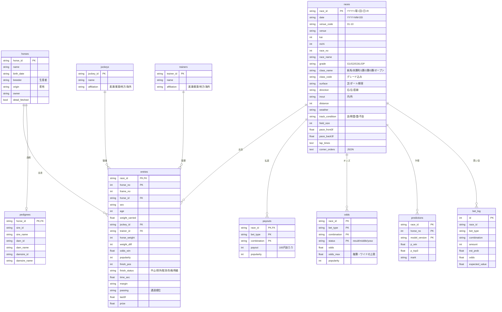

# データベース設計

定義の本体は `keiba/db.py`（SQLAlchemy Core）です。既定は SQLite（`data/keiba.db`）で、
`config.yaml` の `database.url` を PostgreSQL の URL に変えればそのまま移せます
（upsert は SQLite と PostgreSQL の両方の書き方に対応しています）。

## ER図

## テーブルの説明

| テーブル | 主キー | 内容 | 取得元 |
|---|---|---|---|
| races | race_id | レースの条件（日付・場・距離・芝ダ・回り・内外・天候・馬場・クラス・頭数・前後半3F・ラップ・コーナー通過順） | db.netkeiba.com/race/{id}/ |
| entries | race_id, horse_no | 出走馬ごとの結果（枠・馬番・性齢・斤量・騎手・調教師・馬体重・単勝オッズ・人気・着順・タイム・着差・通過順・上がり3F） | 同上 |
| horses | horse_id | 馬名・生年月日・生産者・産地・馬主 | db.netkeiba.com/horse/{id}/ |
| pedigrees | horse_id | 父・母・母父 | db.netkeiba.com/horse/ped/{id}/ |
| jockeys | jockey_id | 騎手名・所属 | db.netkeiba.com/jockey/{id}/ |
| trainers | trainer_id | 調教師名・所属（結果表の [東]/[西]/[地] から） | 結果ページ |
| payouts | race_id, bet_type, combination | 全券種の払戻金（同着で複数行あり） | 結果ページ |
| odds | race_id, bet_type, combination, status | 確定オッズ（status=result）と当日の最新オッズ | race.netkeiba.com のオッズAPI |
| predictions | race_id, horse_no, model_version | 土日の朝に自動で出した予想（推定勝率・複勝率・印） | アプリ |
| bet_log | id | 自動予想で提案した買い目（日曜の答え合わせ用） | アプリ |
| scrape_progress | kind, key | 取得済みの記録（途中から再開するため） | アプリ |
| model_runs | version | 学習したモデルの成績と、採用したかどうか | アプリ |

## 補足
- `finish_pos` は着順の数字。中止・除外・取消・失格は NULL で、理由は `finish_status` に入ります。降着は着順（降着後の順位）が入り、`finish_status='降着'` になります。
- 脚質（逃げ/先行/差し/追込）は保存せず、`passing`（通過順位）と頭数から集計時に計算します（`keiba/features.py`）。
- 確定オッズ（odds テーブル）は取得量が多いため、`config.yaml` の `scraper.final_odds_since` 以降のレースだけを取得します。
